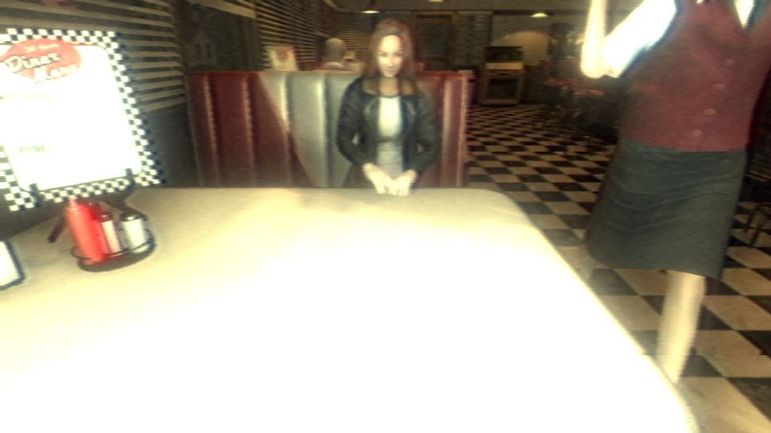
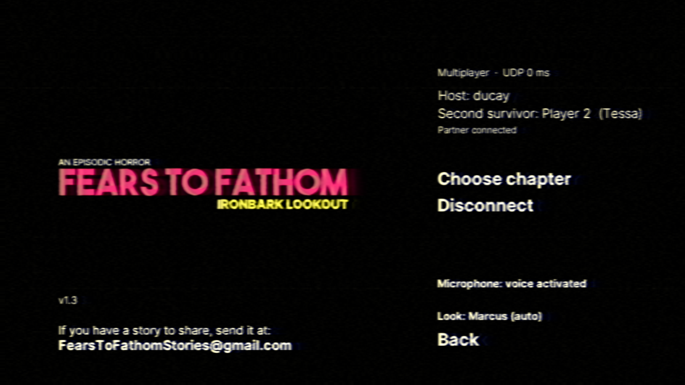
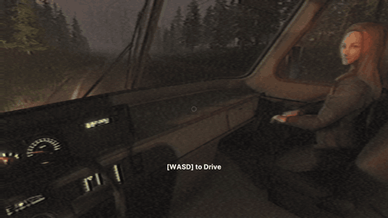
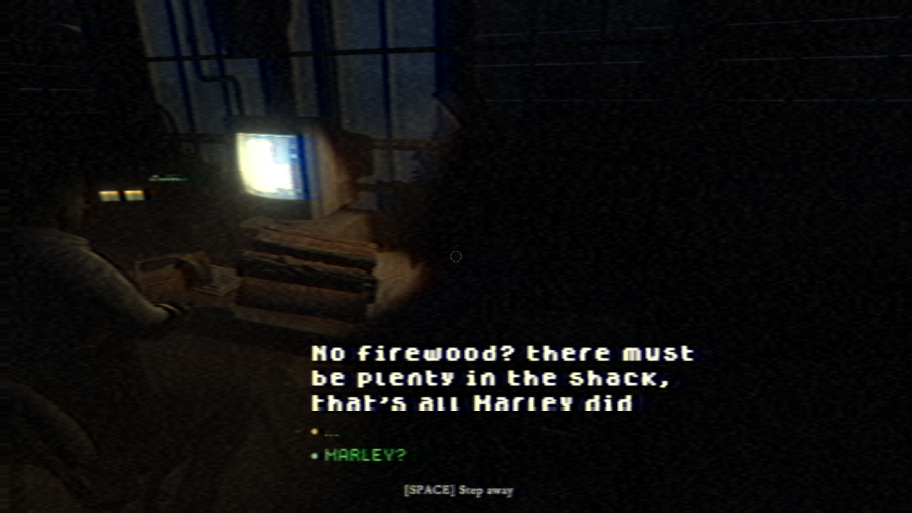
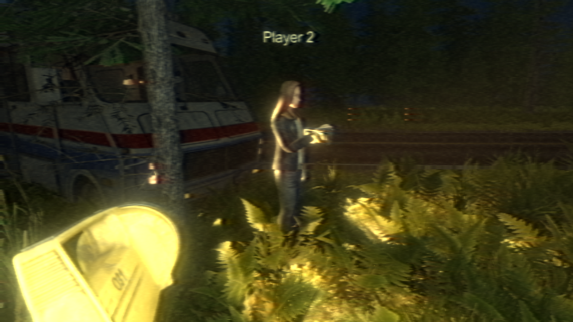
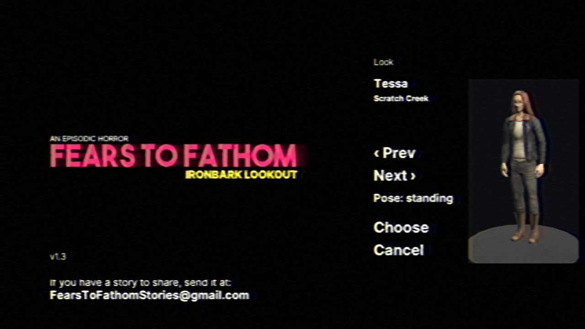
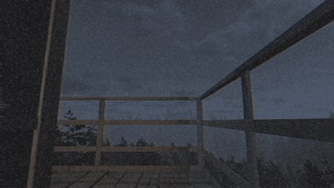

# Ironbark Coop

**Two-player online co-op for _Fears to Fathom: Ironbark Lookout_, in the style of the series' own online episode, _Scratch Creek_.**
**Кооператив на двоих для _Fears to Fathom: Ironbark Lookout_ по образцу онлайн-части серии, _Scratch Creek_.**

[English](#english) · [Русский](#русский) · [Changelog / Изменения](CHANGELOG.md) · [Releases / Релизы](../../releases)



> Unofficial fan mod. Not affiliated with Fears to Fathom or its developers. The repository and the releases contain **no files of either game**: models, sounds and animations are read at runtime from the player's own installed copies of Ironbark Lookout and Scratch Creek.
>
> Неофициальный фанатский мод, не связан с разработчиками Fears to Fathom. В репозитории и релизах **нет файлов игр**: модели, звуки и анимации мод читает во время игры из ваших установленных копий Ironbark Lookout и Scratch Creek.

---

## English

You both play the whole episode together, from the drive to the trail's end. Each of you has your own body, flashlight and inventory. Either of you can move the story forward, and the story is told by both of you.

### Screenshots

| | |
|---|---|
|  |  |
|  |  |
|  | |

<details>
<summary><b>⚠ Spoiler: the cultist / Спойлер: культист</b></summary>



</details>

### Requirements

- **Fears to Fathom: Ironbark Lookout** for both players, **the same version**. The installer prints a "game build code"; yours and your friend's must match.
- **Fears to Fathom: Scratch Creek** is optional. With it you can look like Marcus or Tessa. Without it you pick one of Ironbark's own people (the ranger, the diner waitress, the man in a suit), read from your Ironbark install.
- Windows x64, a microphone for voice chat.
- A shared network: LAN, a virtual LAN (**Radmin VPN**, ZeroTier, Tailscale) or a forwarded port on the router.

### Install

1. Download `IronbarkCoop-<version>.zip` from [Releases](../../releases) and unpack it anywhere.
2. Close the game and run `install.bat`. It finds the game folder by itself (Steam libraries) or asks for the path.
3. Compare the "game build code" with your friend.
4. On first start the mod spends a few seconds reading the characters from your Scratch Creek and caches them in `BepInEx\cache`. Nothing is downloaded.

Uninstall: `uninstall.bat` (it asks before removing BepInEx, which other mods may use).

### Playing together

1. Main menu → **Multiplayer**.
2. The **host** presses **Host game** and gets a **code for your friend** (`IB-XXXXX-XXXXX`). Send it; the **Copy code** button helps.
3. The **friend** pastes the code (or the host's IP) and presses **Join**.
4. When both are in, the host presses **Choose chapter** and starts a new game or continues a save. The friend follows into the same scene and night.
5. If Windows asks about the firewall, allow access. Port **25061**, TCP and UDP.

The code carries an address you can be reached at: the external one (if UPnP worked), else Radmin/ZeroTier/Tailscale, else LAN. If the connection drops, just connect again: the game catches you up to the current night and world state.

**Auto port (UPnP, experimental)** is a switch in the Multiplayer menu. It asks the router to open the port so you can play without a VPN.

### Controls

- **Just talk**: the microphone opens when you speak, as in Scratch Creek. The **Microphone** line in the Multiplayer menu switches between voice activated, push-to-talk (**V**) and off. A small mark in the bottom-left corner shows when you are heard.
- **Ctrl** (hold): crouch, as in Scratch Creek.
- **Left click on the passenger seat**: sit next to the driver. **Space**: stand up.
- **Left click on an answer** in your partner's radio talk: your vote. **Space**: step away from the talk.
- Everything else is as in the game.

### What you get

- **The story told by two.** While you are connected, the narration, the thoughts, Connor on the radio, the phone and everyone you meet speak to both of you: "we didn't know what to make of it", "you two", "new folks". The narrator is Jack Nelson and his partner. Lines about something only one of you does are worded without a person ("hands were full"). English and Russian; other languages keep the game's text.
- **Your look**, picked in the Multiplayer menu (**Look**) in a 3D view with every pose: Marcus and Tessa (with Scratch Creek), the ranger, the waitress and the man in a suit (from Ironbark itself). **Role** is separate: Marcus (the host, in "auto") leads the story.
- **Animations** from Scratch Creek when you have it, otherwise Ironbark's own. Flashlight and items are held in the hands.
- **3D proximity voice**: full near you, fading out by about 12 m, muffled behind walls; Scratch Creek's speaking icon over the talker. In the credits you hear each other as on a call.
- **A shared world**: doors, lights, generator, stove, blinds, items and night progress are the same for both, and either of you can do the tasks. Each of you has your own inventory.
- **The diner**: Marcus sits where the food is served, Tessa across; the waitress brings each of you a tray.
- **Rides**: driver and passenger seat, or stand in the cab. The ride's shake is felt inside; wheel, engine, horn and radio are shared.
- **The tower**: one desk chair and one computer (booted once, windows shared). You read Connor's radio talks together and answer them together; coloured dots show who picked what.
- **Sleep, Scratch Creek style**: whoever lies down first waits on their half of the bed; the night ends when both are in bed.
- **Reading together**: on the black text screens, whoever reads faster waits for the other.
- **Scares stay personal**: only the one who ran into a scare gets it.

<details>
<summary><b>⚠ Spoilers: night by night (story events)</b></summary>

- **Night 2**: Tessa wakes up while Marcus dreams of a dark forest and hears her from far away.
- **The trail to the smoke (day 3)**: go together or one alone. Whoever stays gets chores at the tower and then a nap.
- **Night 4**: Kayla's recipe, cooked together; two trays from the oven and supper on the bed. Then Marcus's walk to the porta-potty.
- **Night 5**: one cultist for both. Whoever he notices is hunted, and the partner sees it.
- **Night 6**: the ranger's visit, the leftovers, firewood for the stove.
- **Night 8 and the trail's end, chased as in Scratch Creek**: the cultist hunts the closest player who is not hidden (under the bed, in the porta-potty). A death is the team's: the partner sees it happen, then you both start the chase again. The run starts only when both of you are ready, so nobody is left behind.

</details>

### Configuration

`BepInEx\config\astra.ironbark.coop.cfg`

| Section / key | What it does |
|---|---|
| Character / Survivor | Story role: `auto`, `marcus` or `tessa`. |
| Character / Look | How you look: `auto`, `marcus`, `tessa`, `ib-ranger`, `ib-waitress`, `ib-suitguy` (set from the menu). |
| Character / ScratchCreekPath | Scratch Creek data folder, if it was not found automatically; `none` means don't use it. |
| Session / PlayerName | Name over your character; empty means your Steam or Windows name. |
| Session / Code | Session code for connecting by IP (the same for both). |
| Network / UPnP | Experimental automatic port opening. |
| Voice / Input | `VoiceActivation` (default), `PushToTalk` or `Off` (set from the menu). |
| Voice / PushToTalkKey, ActivationLevel, PartnerVolume, Microphone | Push-to-talk key, the lowest level that opens the microphone, your partner's volume, the microphone to use. |

### What is in the release zip

| Path | What it is |
|---|---|
| `install.bat`, `install.ps1` | Installer: finds the game, copies `game\*` into it, prints the game build code. |
| `uninstall.bat`, `uninstall.ps1` | Removes the mod and its config; BepInEx only if you agree. |
| `game\winhttp.dll`, `game\doorstop_config.ini`, `game\.doorstop_version`, `game\changelog.txt`, `game\BepInEx\core\*` | BepInEx 5.4.23.5 x64 mod loader, official files, unmodified. |
| `game\BepInEx\plugins\IronbarkCoop\IronbarkCoop.dll` | The mod. |
| `game\BepInEx\plugins\IronbarkCoop\Concentus.dll` | Opus voice codec (managed). |
| `game\BepInEx\plugins\IronbarkCoop\AssetsTools.NET.dll`, `classdata.tpk` | Reads the characters and animations from your own Ironbark Lookout (and Scratch Creek, if installed). |
| `game\BepInEx\plugins\IronbarkCoop\System.*.dll` | .NET support libraries for the above. |
| `licenses\` | This mod's licence, third-party licences and a SHA-256 manifest of every file. |
| `README.md`, `CHANGELOG.md` | This text and the change history. |

### Troubleshooting

- The log is `BepInEx\LogOutput.log` in the game folder; lines from the mod start with `[Ironbark Cooperative]`.
- "Version mismatch": both must have the same game build code and the same mod version.
- Cannot connect: try the host's Radmin VPN/ZeroTier address, allow the game in the Windows firewall, or forward port 25061 (TCP+UDP).
- Your partner does not hear you: check the **Microphone** line in the Multiplayer menu and the corner mark while you speak. With a quiet microphone, lower `Voice / ActivationLevel`.
- Marcus and Tessa are missing from the Look list: Scratch Creek was not found, so set `Character / ScratchCreekPath`.

### Status

Tested automatically on two real copies of the game on one PC (31 test groups: network with packet loss and TCP fallback, menu and join code, avatars and animations, voice and the voice gate, shared story, personal scares, chores, every campaign scene, continue and reconnect, rides, diner, tower, every night, both chases, the credits, the wording for two, playing without Scratch Creek). The whole campaign has been played through by people on one PC.

**Not yet verified:** a session over the internet between two PCs, UPnP on a real router, the Steam connection path.

**Known limitations:** only the waitress, the ranger and the cultists are synced, other NPCs are per player (for personal scares); getting in and out of vehicles has no animation; the partner's view of the computer screen is a small picture updated twice a second.

### Building from source

Requires the .NET SDK (6+), a copy of the game and an unpacked [BepInEx 5.4.23.5 x64](https://github.com/BepInEx/BepInEx/releases/tag/v5.4.23.5).

```
dotnet build src -c Release -p:GameDir="<game folder>" -p:LoaderDir="<BepInEx folder>\BepInEx\core"
powershell -File tools\make-release.ps1 -Version <x.y.z> -LoaderDir "<BepInEx folder>"
```

The build references the game's own assemblies from your install; none of them are in this repository. `tools\make-release.ps1` refuses to package any game file, decompiled source, `.pdb`, image or cache. `src\Wording.json` holds the new wording for two (English and Russian lines that replace the game's ones while a partner is connected).

### Licence and credits

- Mod source code: [MIT](LICENSE).
- [BepInEx](https://github.com/BepInEx/BepInEx) (LGPL-2.1) with HarmonyX, MonoMod, Mono.Cecil (MIT); [Concentus](https://github.com/lostromb/concentus) (BSD-3-Clause); [AssetsTools.NET](https://github.com/nesrak1/AssetsTools.NET) and `classdata.tpk` from [UABEA](https://github.com/nesrak1/UABEA) (MIT); .NET System libraries (MIT). Details in [licenses/THIRD-PARTY.txt](licenses/THIRD-PARTY.txt).
- Fears to Fathom, Ironbark Lookout and Scratch Creek belong to their owners. Screenshots show the mod running in the game.
- Made with the help of an AI coding assistant (Claude, by Anthropic) under the author's direction and playtesting.

---

## Русский

Вы проходите весь эпизод вдвоём, от поездки до конца тропы. У каждого своё тело, свой фонарик и инвентарь. Двигать сюжет может любой из вас, а история рассказывается от вас обоих.

### Скриншоты

См. [английский раздел](#screenshots).

### Что нужно

- **Fears to Fathom: Ironbark Lookout** у обоих, **одной версии**. Установщик покажет «код версии игры», и у вас с другом он должен совпасть.
- **Fears to Fathom: Scratch Creek** не обязательна. С ней можно выглядеть как Маркус или Тесса. Без неё выбираете одного из людей самой Ironbark (смотритель, официантка из закусочной, мужчина в костюме): мод берёт их из вашей установленной Ironbark.
- Windows x64, микрофон для голосового чата.
- Одна сеть: локальная, виртуальная (**Radmin VPN**, ZeroTier, Tailscale) или открытый порт на роутере.

### Установка

1. Скачайте `IronbarkCoop-<версия>.zip` в разделе [Releases](../../releases) и распакуйте куда угодно.
2. Закройте игру и запустите `install.bat`. Он найдёт папку игры сам (библиотеки Steam) или спросит путь.
3. Сравните с другом «код версии игры».
4. При первом запуске мод за несколько секунд прочитает персонажей из вашей Scratch Creek и сохранит их в `BepInEx\cache`. Скачивать ничего не нужно.

Удаление: `uninstall.bat` (BepInEx удаляется только с вашего согласия: им могут пользоваться другие моды).

### Как играть вместе

1. В главном меню выберите **«Мультиплеер»**.
2. **Хост** нажимает **«Создать игру»** и видит **«Код для друга»** (вида `IB-XXXXX-XXXXX`). Отправьте код другу, удобнее всего кнопкой «Скопировать код».
3. **Друг** вставляет код (или IP хоста) в поле и нажимает **«Подключиться»**.
4. Когда оба на месте, хост нажимает **«Выбрать главу»** и начинает новую игру или продолжает сохранение. Друг попадает в ту же сцену и ночь автоматически.
5. Если Windows спросит про брандмауэр, разрешите доступ. Порт **25061**, TCP и UDP.

Код содержит адрес, по которому до вас можно достучаться: внешний (если сработал UPnP), иначе Radmin/ZeroTier/Tailscale, иначе локальной сети. Если оборвётся связь, просто подключитесь снова: игра догонит вас до текущей ночи и состояния мира.

**Авто-порт UPnP (эксперимент)** — переключатель в меню мультиплеера. Он просит роутер открыть порт, чтобы играть без VPN. Работает только с роутерами, где UPnP включён.

### Управление

- **Просто говорите**: микрофон включается, когда вы говорите, как в Scratch Creek. Строка **«Микрофон»** в меню мультиплеера переключает: по голосу, по кнопке (**V**) или выключен. Небольшая метка в левом нижнем углу показывает, что вас слышно.
- **Ctrl** (удерживать): присесть, как в Scratch Creek. Отпустили — встали (если над головой есть место).
- **ЛКМ по пассажирскому сиденью**: сесть рядом с водителем. **Пробел**: встать.
- **ЛКМ по варианту ответа** в разговоре партнёра по рации: ваш голос за ответ. **Пробел**: отойти от разговора.
- Остальное — как в игре.

### Что вас ждёт

- **История на двоих.** Пока вы подключены, рассказ, мысли, Коннор по рации, телефон и все, кого вы встречаете, обращаются к вам обоим: «мы не знали, что с этим делать», «вы», «новички». Рассказчики — Джек Нельсон и его напарник. Фразы о том, что делает только один из вас, звучат безлично («руки заняты»). На русском и английском; на других языках остаётся текст игры.
- **Внешность** выбирается в меню мультиплеера («Внешность») в 3D-просмотре со всеми позами: Маркус и Тесса (со Scratch Creek), смотритель, официантка и мужчина в костюме (из самой Ironbark). **Роль** — отдельная настройка: сюжет ведёт Маркус (в режиме «авто» это хост).
- **Анимации** из Scratch Creek, если она есть, иначе — из самой Ironbark. Фонарик и предметы в руках.
- **Голос в 3D**: в полную силу вблизи, дальше затихает и пропадает примерно через 12 м, за стенами глуше. Над говорящим иконка речи из Scratch Creek. В титрах друг друга слышно как по телефону.
- **Общий мир**: двери, свет, генератор, печь, жалюзи, предметы и прогресс ночи совпадают у обоих, а задания может выполнять любой. Инвентарь у каждого свой.
- **Закусочная**: Маркус садится туда, куда приносят еду, Тесса — напротив; официантка приносит поднос каждому.
- **Поездки**: водитель и пассажир, или стоя в салоне. Тряску чувствуют все в салоне; руль, двигатель, гудок и радио общие.
- **Вышка**: один стул и один компьютер (включают его один раз, окна общие). Разговоры с Коннором по рации видите оба и отвечаете вместе; цветные точки показывают, кто что выбрал.
- **Сон, как в Scratch Creek**: кто лёг первым, ждёт на своей половине кровати; ночь кончается, когда легли оба.
- **Читаете вместе**: на чёрных экранах с текстом тот, кто прочитал быстрее, ждёт другого.
- **Скримеры личные**: пугается только тот, кто сам на них наткнулся.

<details>
<summary><b>⚠ Спойлеры: что происходит по ночам (события сюжета)</b></summary>

- **Вторая ночь**: просыпается Тесса, а Маркусу снится тёмный лес, и он слышит её издалека.
- **Поход к дыму (день 3)**: вдвоём или одному. Кто остался, получает дела на вышке, а потом дремлет.
- **Четвёртая ночь**: рецепт Кайлы готовите вместе, из духовки два подноса, ужин на кровати. Потом поход Маркуса к биотуалету.
- **Пятая ночь**: один культист на двоих. Кого он заметил, за тем и гонится, а напарник это видит.
- **Шестая ночь**: визит рейнджера, остатки ужина, дрова для печи.
- **Восьмая ночь и конец тропы, погони как в Scratch Creek**: культист гонится за ближайшим, кто не спрятался (под кроватью, в биотуалете). Смерть общая: напарник видит, как это происходит, и погоня начинается заново для обоих. Бежать можно, только когда готовы оба, так что никто не останется позади.

</details>

### Настройки

Файл `BepInEx\config\astra.ironbark.coop.cfg`.

| Раздел / ключ | Что делает |
|---|---|
| Character / Survivor | Роль в сюжете: `auto`, `marcus` или `tessa`. |
| Character / Look | Внешность: `auto`, `marcus`, `tessa`, `ib-ranger`, `ib-waitress`, `ib-suitguy` (выбирается в меню). |
| Character / ScratchCreekPath | Папка данных Scratch Creek, если её не нашло автоматически; `none` — не использовать. |
| Session / PlayerName | Ник над персонажем; пусто — имя Steam или Windows. |
| Session / Code | Код сессии для подключения по IP (у обоих одинаковый). |
| Network / UPnP | Экспериментальное автоматическое открытие порта. |
| Voice / Input | `VoiceActivation` (по умолчанию), `PushToTalk` или `Off` (выбирается в меню). |
| Voice / PushToTalkKey, ActivationLevel, PartnerVolume, Microphone | Клавиша рации, самый тихий уровень, при котором включается микрофон, громкость напарника, какой микрофон использовать. |

### Что лежит в архиве релиза

| Путь | Что это |
|---|---|
| `install.bat`, `install.ps1` | Установщик: находит игру, копирует в неё `game\*`, показывает код версии игры. |
| `uninstall.bat`, `uninstall.ps1` | Удаляет мод и его настройки; BepInEx — только если согласитесь. |
| `game\winhttp.dll`, `game\doorstop_config.ini`, `game\.doorstop_version`, `game\changelog.txt`, `game\BepInEx\core\*` | Загрузчик модов BepInEx 5.4.23.5 x64, официальные файлы без изменений. |
| `game\BepInEx\plugins\IronbarkCoop\IronbarkCoop.dll` | Сам мод. |
| `game\BepInEx\plugins\IronbarkCoop\Concentus.dll` | Голосовой кодек Opus. |
| `game\BepInEx\plugins\IronbarkCoop\AssetsTools.NET.dll`, `classdata.tpk` | Чтение персонажей и анимаций из вашей установленной Ironbark Lookout (и Scratch Creek, если она есть). |
| `game\BepInEx\plugins\IronbarkCoop\System.*.dll` | Вспомогательные библиотеки .NET. |
| `licenses\` | Лицензия мода, лицензии сторонних компонентов и SHA-256 каждого файла. |
| `README.md`, `CHANGELOG.md` | Этот текст и история изменений. |

### Если что-то не так

- Лог — `BepInEx\LogOutput.log` в папке игры; строки мода начинаются с `[Ironbark Cooperative]`.
- «Несовпадение версий»: у обоих должны совпадать код версии игры и версия мода.
- Не подключается: попробуйте адрес хоста в Radmin VPN/ZeroTier, разрешите игру в брандмауэре Windows или откройте порт 25061 (TCP+UDP).
- Напарник вас не слышит: проверьте строку «Микрофон» в меню мультиплеера и метку в углу, пока говорите. Если микрофон тихий, уменьшите `Voice / ActivationLevel`.
- В списке внешностей нет Маркуса и Тессы: Scratch Creek не найдена, укажите `Character / ScratchCreekPath`.

### Что проверено и что нет

Проверено автотестами на двух настоящих копиях игры на одном компьютере (31 группа тестов): сеть с потерями и переход на TCP, меню и код подключения, персонажи и анимации, голос и его включение по речи, общий сюжет, личные скримеры, обязанности, все сцены кампании, продолжение и переподключение, поездки, закусочная, вышка, все ночи, обе погони, титры, текст на двоих, игра без Scratch Creek. Вся кампания пройдена людьми на одном компьютере.

Ещё **не** проверено: игра через интернет между двумя ПК, UPnP на реальном роутере, подключение через Steam.

**Известные ограничения:** синхронизируются только официантка, рейнджер и культисты, остальные NPC у каждого свои (ради личных скримеров); посадка в машину и выход без анимации; картинка экрана компьютера у партнёра небольшая и обновляется дважды в секунду.

### Сборка из исходников

Нужны .NET SDK (6+), установленная игра и распакованный [BepInEx 5.4.23.5 x64](https://github.com/BepInEx/BepInEx/releases/tag/v5.4.23.5). Команды — в английском разделе выше. Сборка ссылается на библиотеки игры из вашей установки; в репозитории их нет. В `src\Wording.json` лежат новые фразы на двоих (строки на русском и английском, которые заменяют фразы игры, пока подключён напарник).

### Лицензия и благодарности

- Исходный код мода: [MIT](LICENSE).
- BepInEx (LGPL-2.1), HarmonyX, MonoMod, Mono.Cecil (MIT), Concentus (BSD-3), AssetsTools.NET и `classdata.tpk` из UABEA (MIT), библиотеки .NET (MIT). Подробно: [licenses/THIRD-PARTY.txt](licenses/THIRD-PARTY.txt).
- Fears to Fathom, Ironbark Lookout и Scratch Creek принадлежат их владельцам. На скриншотах — мод в игре.
- Сделано с помощью ИИ-ассистента (Claude от Anthropic) под руководством автора и по его плейтестам.
